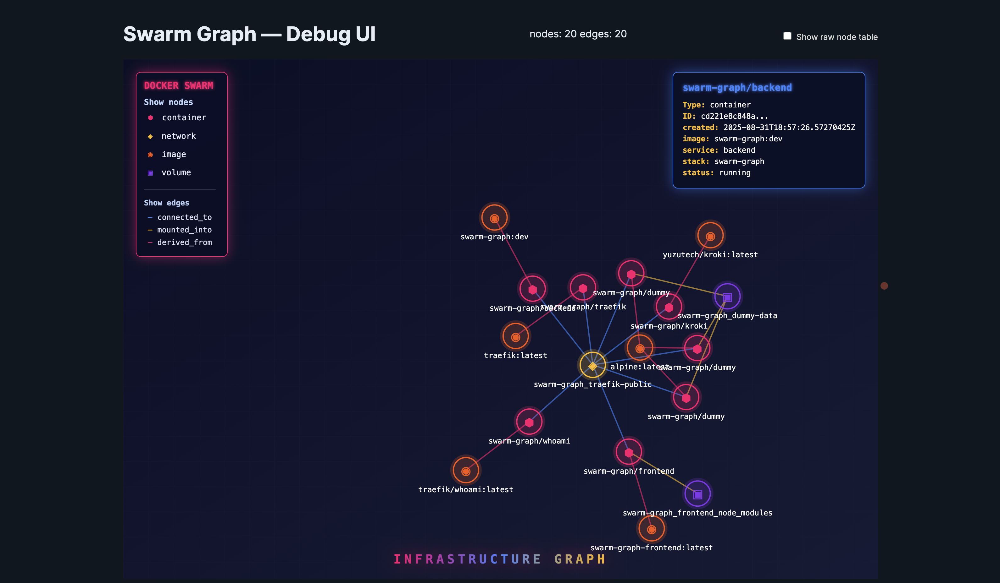
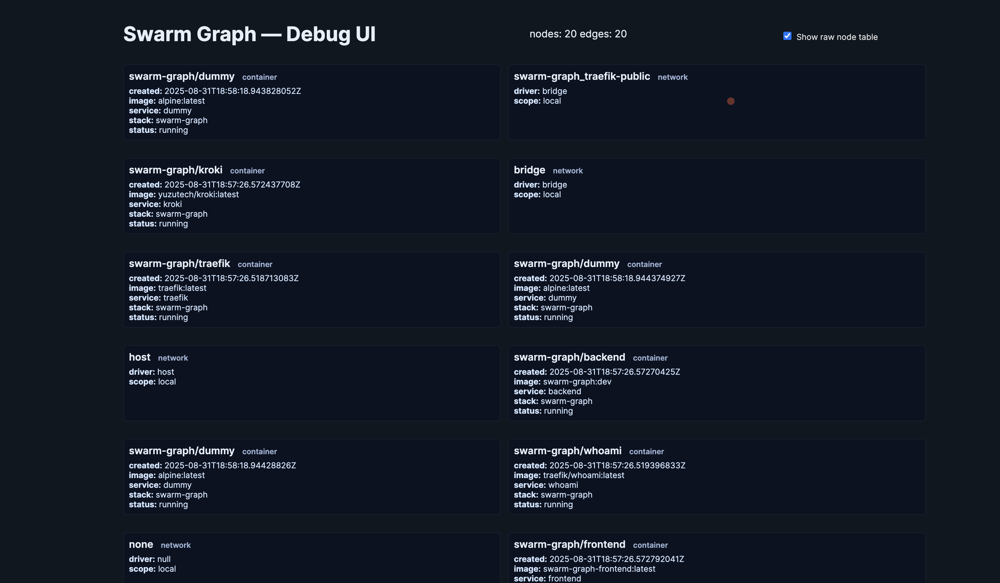

# TODO

- [ ] Create the backend folder for the go app, better isolation (P1)
  - [ ] fix actual go module name to include github (P1)
  - [ ] update import paths to use the new module name (P1)
- [ ] Create service/image/container asset layer
  - [ ] i.e., show traefik logo and create basic node structure
    - We want to use some of this in the mermaid renderer as well probably so company logos show up
- [ ] Make it so we use the local version of kroki (P2)
- [ ] Make it also use the local version of the frontend (P2)
- [ ] Maybe add metrics to this, using my prom-sniffer image (P5)

## Screenshots





## Swarm Graph — local Docker topology explorer

Lightweight agent that watches a Docker daemon, keeps an in-memory graph of images, containers, networks, and volumes, and exposes a tiny HTTP API and a debug UI.

This repo is optimized for local development: fast rebuilds, a Vite frontend, and a small Go agent that talks to your Docker socket.

Quick highlights

- Agent HTTP API: `http://localhost:9123`
- Frontend (Vite): `http://localhost:5173`

API endpoints

- `GET /graph.json` — graph snapshot (JSON)
- `GET /graph.mmd`  — mermaid source
- `GET /graph.svg`  — server-rendered SVG (via Kroki)

Prerequisites

- Go 1.23+
- Docker (for integration and running services)
- task (optional) — convenience task runner used in this repo
- yarn / npm (for frontend dev)

Fast development (recommended)

1) Install Go deps and tidy the module:

```bash
task deps
task tidy
```

1. Start the full stack for local development (agent + frontend):

```bash
# from repo root
docker compose up --build
```

The `docker-compose.yml` includes the agent (backend), the vite frontend, and kroki. The frontend runs on port 5173 and talks to the agent on 9123.

Run only the agent locally (dev with live reload)

```bash
# build once and run
task build
./bin/agent

# or run with live reload (air)
task dev
```

Frontend development

```bash
cd frontend
# preferred: use yarn (corepack enabled in Dockerfile); npm also works
yarn install
yarn dev
```

Useful Taskfile targets

- `task build` — compile agent into `bin/agent`
- `task run` — run agent locally with `go run`
- `task dev` — run air (live reload)
- `task docker:build` — build a production image
- `task docker:up` / `task docker:down` — bring up / down full compose stack
- `task docker:dev:up` — start compose for dev (mounts source)

Configuration and environment

- `DOCKER_HOST` — point the agent to a non-default Docker daemon
- `KROKI_URL` — change the Kroki server used for server-side rendering (default: `https://kroki.io`)
- `CORS_ORIGIN` — controls allowed origin for the HTTP API (default `*` in dev)

Troubleshooting notes

- If the frontend fails with an esbuild platform error when running in Docker, ensure host `node_modules` are not being copied into the image. The repo includes `.dockerignore` and the compose file mounts a named volume for `/app/node_modules` to avoid this.
- If the browser fetch to `/graph.json` is blocked by CORS, set `CORS_ORIGIN` on the agent or run both services on the same origin (via a reverse proxy).

Developer tips

- The frontend hook `useDockerGraph` normalizes the API shape (supports both map-based `nodes` and array `Nodes`). If you change the API, update the hook accordingly.
- Use `docker compose logs -f frontend` and `docker compose logs -f backend` to tail logs while developing.

Contributing

- Open issues or PRs for bugs and small enhancements. Keep changes focused and test locally with the compose setup.

License & credits

- MIT-style (see repository root)

Have fun exploring your local Docker stack — go make it sexy.
